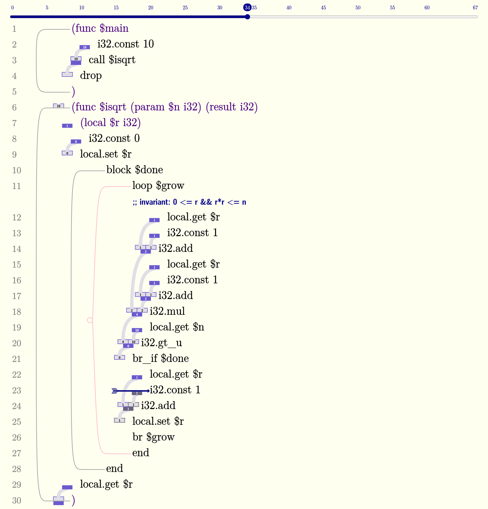
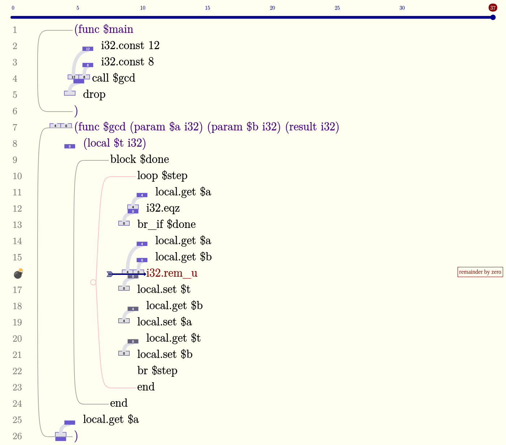
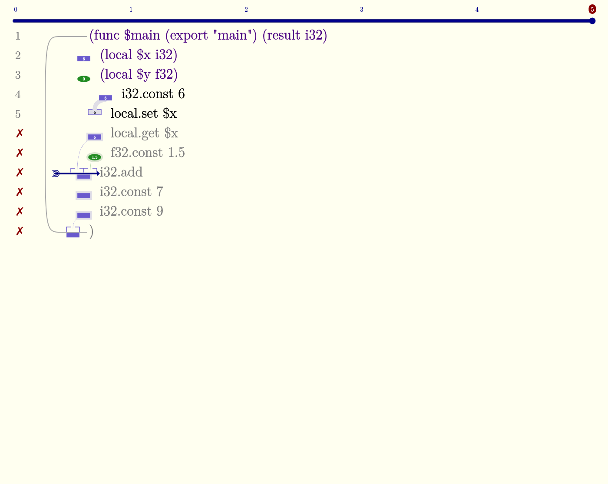

# Real Codillon vs. our renderings

Added 2026-10-23, after building upstream Codillon (commit `005a19f`) locally with `trunk build --release` and
driving it headlessly (`tools/codillon-shot.mjs`: loads a program through the `codillon_content` localStorage key,
reloads, optionally moves the step slider, captures the page). Until this point every rendering in this study was
derived from *reading* Codillon's source (00-codillon-today.md), not from seeing it run.

Test programs are in `img/real-codillon/*.wat`. Codillon exports the **first** function as `main`, calls it with no
arguments, and expects no return value, so each program starts with a `$main` that calls the function under test and
`drop`s the result.

| | |
|---|---|
|  |  |
| isqrt(10), slider at step 34 of 67 | gcd with the guard on the wrong variable: trap at step 37 |

A type error (`f32` into `i32.add`) and stranded values.

## What we got right
- Ivory background, MLModern serif at 24 pt for code, indigo meta lines, darkblue comments.
- Type shapes and exact colors: slate-blue i32 rectangles, input cups (muted fill, outline) above a rule, solid
  outputs below; values in tiny white text inside output shapes; older values grayed.
- Gutter glyphs replacing the line number: 💣 for a trap (with the instruction text turned darkred), ✗ for invalid
  lines (text turns gray).
- Commentary is a small darkred bordered label; there is no error panel.
- Sticky step slider with numbered ticks, a darkblue pill for the current step and a darkred pill for the final
  (error) step.

## What we got wrong
1. **Fractions sit to the left of the code, not in a right margin.** Each instruction's fraction is drawn immediately
   left of its text, and its x position follows the code's indentation (deeper blocks → further right). The code is
   indented *by* the fraction column. All ten prototypes and the walkthrough put fractions in a fixed column to the
   right of the code.
2. **Connections are wide, pale ribbons.** Producer-to-consumer curves are ~7 px wide, pale lavender-gray
   (`#e0e0eb`-ish), and short: they run down-and-left from an output shape to the cup it feeds, hugging the left edge
   of the code. We drew thin 1–2 px colored lines.
3. **Frames are rounded brackets, and loops are pink.** `func`, `block` and `if` frames are gray rounded brackets
   on the left, from the opening line to its `end`; `loop` frames are pale pink. A loop that was taken at runtime gets a
   small open circle on its bracket. We drew straight thin vertical lines in one color.
4. **The arrow is a navy chevron-tailed arrow** pointing from the left at the current instruction's fraction.
5. **Commentary floats to the far right edge of the window**, right-aligned, not next to the code.
6. **Invalid lines turn gray** (text, not just the gutter), and stranded outputs get a thick pale halo.

## Consequence for the design
The right side of a real Codillon line is empty except for the far-right commentary. That is good news: it is the
natural home for everything this study adds *on failure* (the hole box, suggestion chips, sequent fact chips), and it
keeps the left side — the part students already know — almost unchanged. The walkthrough is revised accordingly:

- Fractions move to the left of the code at Codillon's indentation-driven x, with Codillon's connection, frame,
  loop-taken, arrow and slider styling.
- A refined shape stays on the left and is wider (84 × 14), so the code column shifts right by the extra width on
  refined lines only within a function; unrefined shapes keep 30 × 11.
- Fact chips, hole lines and the commentary label live to the right of the code.
- MLModern fonts are embedded so the page matches Codillon's typography.
